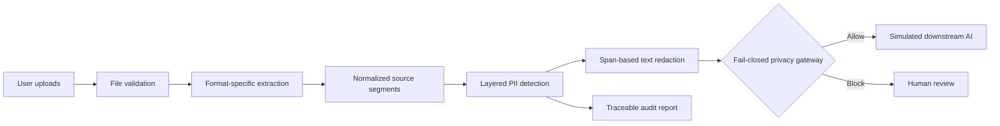

# Solution blueprint

The gateway permits only complete, validated, review-free sanitized text. Uncertain extraction, OCR/image content needing review, validation failure or unresolved low-confidence findings blocks release. The interface labels exports as sanitized text, never as redacted original files.
