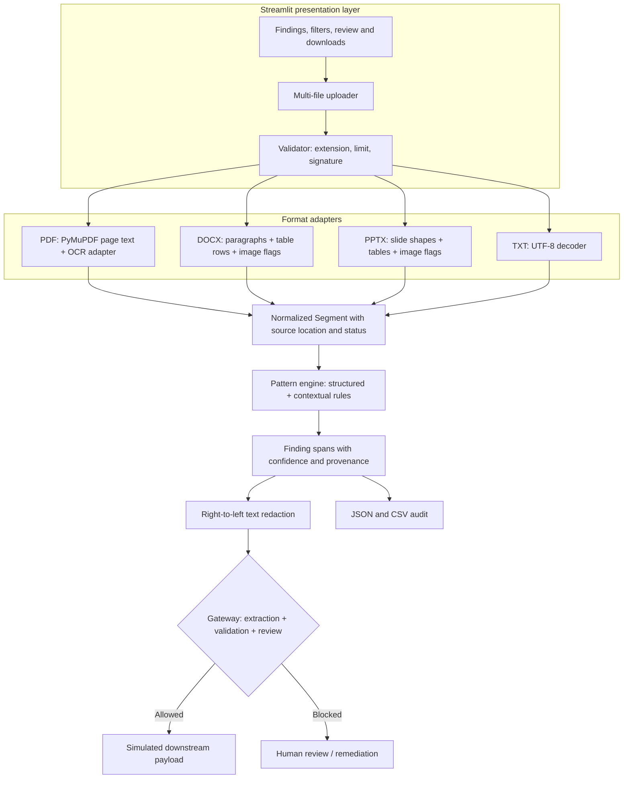

# Technical architecture

**Trust boundaries:** uploaded bytes are treated as untrusted; validation precedes parsing. Original content stays in-process and is never sent to a provider. The gateway returns no eligible payload on a block. Audit output is user initiated and may contain source values, so the interface hides values by default and warns on reveal.

The Streamlit UI passes uploaded bytes to `pipeline.process_uploads`. `validators` enforces extension, size and file signatures before dispatch. PDF extraction uses PyMuPDF and performs Tesseract OCR for image-backed low-text pages. DOCX extraction preserves paragraph order and table rows; PPTX extraction records slide/shape coordinates and tables. Embedded Office images are reported as review blockers.

All extracted content becomes `Segment(filename, location, method, text, status, review_required)`. `pii_engine` emits `Finding` records with entity, value, confidence, method, file, location and character offsets. Regex rules cover structured values; contextual rules require labels such as “Name:” or “Address:”. Overlapping candidates are resolved by confidence. No model download or external network analysis occurs.

`text_redactor` replaces accepted spans from right to left. `gateway.decide_gateway` returns sanitized payload only if extraction, detection, validation and review state satisfy policy. Reports serialize finding provenance. UI hides values by default. `document_redactor` refuses non-TXT files so extracted text is not confused with a sanitized source file.

The simulated handoff is deliberately local. To connect a provider later, place a provider adapter behind the gateway and pass only `GatewayDecision.sanitized_text` after `allowed` is true; do not pass uploaded bytes or original segments.
